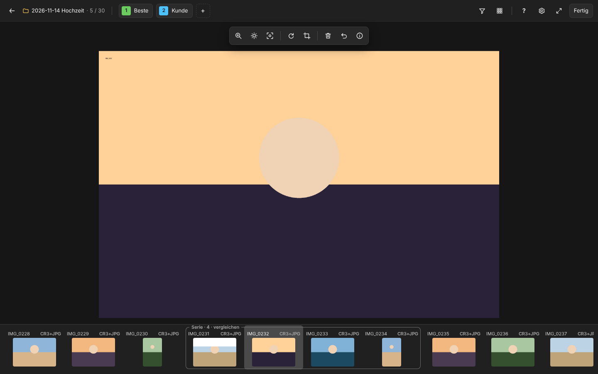

<p align="center">
  
</p>

<h1 align="center">ShotSort</h1>

<p align="center">
  Fotos aus einem Shooting schnell durchsehen und die besten per Tastendruck in Zielordner kopieren.<br>
  Die Originale bleiben dabei immer unverändert.
</p>

<p align="center">
  <a href="https://github.com/0prointer/shotsort/releases/latest"><b>⬇ ShotSort für Windows herunterladen</b></a>
</p>



## Installieren

1. Auf der [Download-Seite](https://github.com/0prointer/shotsort/releases/latest) unter **Assets** die Datei
   `ShotSort_…_x64-setup.exe` herunterladen. Die anderen Dateien dort braucht man nicht.
2. Die Datei öffnen. Windows zeigt beim ersten Mal **„Der Computer wurde durch Windows geschützt“**, weil die App
   nicht von einer bezahlten Stelle zertifiziert ist. Auf **Weitere Informationen → Trotzdem ausführen** klicken.
3. Fertig – ShotSort steht im Startmenü. Administratorrechte sind nicht nötig.

**Updates kommen von selbst:** Gibt es eine neue Version, erscheint beim Start rechts der Hinweis
„Update verfügbar“. Ein Klick auf *Jetzt aktualisieren* genügt, ShotSort startet danach neu.

Entfernen lässt sich die App unter *Einstellungen → Apps*. ShotSort gibt es derzeit nur für Windows 10 und 11.

## So geht's

1. **Quellordner wählen** – den Ordner mit den Bildern des Shootings (oder einfach ins Fenster ziehen).
2. **Zielordner anlegen** – z. B. „Beste“ auf Taste 1, „Kunde“ auf Taste 2. Bis zu neun Stück.
3. **Sortieren starten** und mit den Pfeiltasten durchblättern.
4. Mit **1–9** wird das Bild in den passenden Ordner kopiert, mit **Entf** gelöscht. Auf Wunsch springt ShotSort
   nach dem Kopieren gleich zum nächsten Bild (*Einstellungen → Nach dem Kopieren zum nächsten Bild springen*).

Mit **?** sind jederzeit alle Tastenkürzel zu sehen.

## Was ShotSort kann

- RAW + JPG (+ vorhandene .xmp) mit gleichem Namen werden immer zusammen kopiert
- Nach jedem Kopieren wird die Kopie Byte für Byte mit dem Original verglichen
- Gleicher Name im Ziel: `_2` anhängen oder überspringen – es wird nie etwas überschrieben
- Bilder nach Aufnahmezeit sortiert, auch bei mehreren Kameras; Unterordner wie 100CANON auf Wunsch mit einbeziehen
- Drehen und Zuschneiden (mit Seitenverhältnis und Begradigen) wirken **nur auf die Kopien**:
  RAW bekommt eine `.xmp`-Datei, JPG wird als bearbeitete Kopie gespeichert (EXIF bleibt erhalten)
- Gelöschte Bilder lassen sich im Papierkorb der Sitzung oder mit **Strg+Z** zurückholen
- Rückgängig für Kopieren, Löschen, Bearbeiten und Entfernen
- Prüfhilfen: zu helle und zu dunkle Stellen, Schärfe-Hilfe, Histogramm, Aufnahmedaten
- Serien (Bilder kurz nacheinander) werden erkannt und lassen sich nebeneinander vergleichen, Zoom ist gekoppelt
- Rasteransicht, Filter (alle, nicht kopiert, je Zielordner), Vollbild
- Sitzungen werden gespeichert und lassen sich später fortsetzen; am Ende gibt es eine Zusammenfassung
- Hell/Dunkel, eigene Tastenbelegung, JPG-Qualität u. a. einstellbar

## Tastenkürzel

| Taste | Funktion |
|---|---|
| ← / → | vorheriges / nächstes Bild |
| 1–9 | in Zielordner 1–9 kopieren |
| Leertaste | in Zielordner 1 kopieren |
| Entf | löschen |
| Strg+Z | rückgängig |
| Z | ganzes Bild / 100 % (gedrückt halten: nur kurz 100 %) |
| R / C | drehen / zuschneiden |
| O | zu helle / zu dunkle Stellen |
| P | Schärfe-Hilfe |
| I | Info-Leiste mit Histogramm |
| S | Serie vergleichen |
| Strg+Klick | Bild zum Vergleich hinzufügen |
| X | aus dem Vergleich nehmen |
| G | Rasteransicht |
| F | Vollbild |
| ? | alle Tastenkürzel |

Die Belegung lässt sich unter *Einstellungen → Tastenbelegung* ändern.

## Gut zu wissen

- **Originale bleiben unverändert.** ShotSort kopiert nur. Ausnahme ist *Löschen*: Gelöschte Bilder liegen bis zum
  Ende der Sitzung im versteckten Ordner `.shotsort-papierkorb` im Quellordner und wandern beim Abschluss,
  beim Zurückgehen zum Start oder beim Beenden in den Papierkorb von Windows.
- **Formate:** RAW: CR3, CR2, NEF, ARW, RAF, ORF, RW2, DNG, PEF, SRW u. a.; Bilder: JPG, PNG, TIFF.
  HEIC wird noch nicht unterstützt. Videos werden übersprungen und gezählt.
- **RAW-Vorschau:** Angezeigt wird die Vorschau, die die Kamera in die RAW-Datei schreibt (bei fast allen Kameras
  in voller Größe). Liegt ein JPG daneben, wird das JPG angezeigt.
- **Einstellungen und Sitzungen** liegen in `%APPDATA%\de.shotsort.app`. Beim ersten Start übernimmt ShotSort die
  Einstellungen der früheren Version „Fotosortierer“, falls vorhanden.

---

## Für Entwickler

ShotSort ist mit [Tauri 2](https://tauri.app) gebaut: Oberfläche in HTML/CSS/JavaScript (ohne Build-Schritt),
Dateizugriff und Bildverarbeitung in Rust. Grundsätzlich läuft es auch unter macOS und Linux,
veröffentlicht wird aber nur die Windows-Version.

### Einmalig einrichten

#### Windows

1. **Microsoft C++ Build Tools** installieren: <https://visualstudio.microsoft.com/de/visual-cpp-build-tools/>
   Im Installer „Desktopentwicklung mit C++“ auswählen.
2. **WebView2** ist bei Windows 10/11 schon vorhanden.
3. **Rust** installieren: <https://www.rust-lang.org/tools/install> (rustup-init.exe ausführen, Standard übernehmen)

#### macOS

1. Im Terminal: `xcode-select --install`
2. Rust: `curl --proto '=https' --tlsv1.2 https://sh.rustup.rs -sSf | sh`

#### Linux (Debian/Ubuntu)

```bash
sudo apt update
sudo apt install libwebkit2gtk-4.1-dev build-essential curl wget file libxdo-dev libssl-dev libayatana-appindicator3-dev librsvg2-dev
curl --proto '=https' --tlsv1.2 https://sh.rustup.rs -sSf | sh
```

#### Danach auf allen Systemen

Das Tauri-Werkzeug installieren (dauert ein paar Minuten):

```bash
cargo install tauri-cli --version "^2" --locked
```

### Starten und bauen

Im Ordner `shotsort`:

```bash
cargo tauri dev
```

startet die App zum Ausprobieren. Der erste Start dauert einige Minuten, weil alle Bibliotheken übersetzt werden.
Änderungen an den Dateien in `src/` siehst du nach einem Neuladen des Fensters (Strg+R bzw. ⌘R), Änderungen in `src-tauri/` lösen einen Neustart aus.

```bash
cargo tauri build
```

erstellt die fertige App mit Installationsprogramm.

**Windows:** Das Installationsprogramm liegt danach in
`src-tauri\target\release\bundle\nsis\ShotSort_<Version>_x64-setup.exe`.
Es installiert die App nur für den angemeldeten Benutzer (keine Administratorrechte nötig), legt eine
Verknüpfung im Startmenü an und lässt sich unter *Einstellungen → Apps* wieder entfernen.
Beim ersten Bauen lädt Tauri das Werkzeug NSIS automatisch herunter (Internet nötig).

Weil das Programm nicht digital signiert ist, zeigt Windows beim ersten Start des Installers
„Der Computer wurde durch Windows geschützt“. Dann auf **Weitere Informationen → Trotzdem ausführen** klicken.

Jedes System baut seine eigene Version: Die Mac-Version muss auf einem Mac gebaut werden usw.
Für Mac und Linux in `src-tauri/tauri.conf.json` unter `bundle.targets` z. B. `"all"` eintragen.

### Updates veröffentlichen

ShotSort sucht beim Start bei GitHub (`0prointer/shotsort`) nach einer neueren Version und bietet sie auf dem
Startbildschirm an (auch unter *Einstellungen → Über ShotSort*). Updates sind signiert: Die App installiert
nur Updates, die mit dem eigenen privaten Schlüssel unterschrieben wurden.

Einmalig:
1. Schlüssel erzeugen: `cargo tauri signer generate -w "%USERPROFILE%\.tauri\shotsort.key"`
   Den Inhalt von `shotsort.key.pub` in `src-tauri/tauri.conf.json` bei `plugins.updater.pubkey` eintragen.
   **Die Datei `shotsort.key` und ihr Passwort gut sichern und nie ins Repository legen.** Ohne sie können
   installierte Versionen keine Updates mehr bekommen.
2. Auf GitHub unter *Settings → Secrets and variables → Actions* zwei Secrets anlegen:
   `TAURI_SIGNING_PRIVATE_KEY` (Inhalt von `shotsort.key`) und `TAURI_SIGNING_PRIVATE_KEY_PASSWORD`.

Für jede neue Version:
1. Versionsnummer in `src-tauri/Cargo.toml` erhöhen (z. B. 1.2.0). Die App übernimmt sie von dort.
2. Änderungen committen und pushen.
3. Auf GitHub unter *Actions → Neue Version veröffentlichen → Run workflow* starten.
   GitHub baut die App (ca. 6 Minuten, nach Änderungen an den Bibliotheken auch länger) und veröffentlicht sie als Release `v1.2.0`.

### Aufbau

```
shotsort/
├── .github/workflows/release.yml   baut und veröffentlicht neue Versionen auf GitHub
├── docs/                   Logo und Bildschirmfoto für diese Seite
├── src/                    Oberfläche (HTML, CSS, JavaScript – kein Build-Schritt nötig)
│   ├── index.html
│   ├── styles.css          Farben für Hell/Dunkel stehen oben als Variablen
│   └── js/
│       ├── main.js         Start, Wechsel der Ansichten, Tastatur
│       ├── api.js          Verbindung zum Rust-Teil
│       ├── actions.js      Kopieren, Löschen, Bearbeiten, Rückgängig
│       ├── viewer.js       Bildanzeige mit Zoom und Zuschneiden
│       ├── keys.js         Tastenkürzel (Windows/Mac)
│       ├── store.js        Einstellungen und Sitzungen speichern
│       ├── compareGrid.js  Vergleich mehrerer Bilder
│       └── views/          Start, Einlesen, Sortieren, Papierkorb, Abschluss, Einstellungen
└── src-tauri/              Rust-Teil (Dateien lesen, kopieren, prüfen)
    ├── tauri.conf.json     Fenstergröße, App-Name, Rechte
    └── src/
        ├── lib.rs          alle Befehle, die die Oberfläche aufrufen kann
        ├── scan.rs         Ordner einlesen, RAW+JPG-Paare, Sortierung
        ├── preview.rs      RAW-Vorschau, Miniaturen, Belichtung, Schärfe, Histogramm
        ├── copy.rs         Kopieren mit Prüfung und Namensregel
        ├── edits.rs        Drehen, Zuschneiden, XMP
        ├── files.rs        Löschen/Papierkorb, Speicherplatz
        └── meta.rs         EXIF lesen
```
